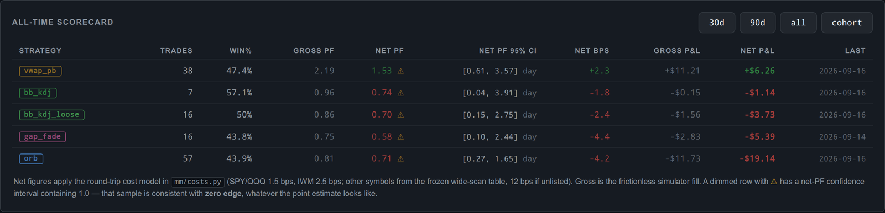
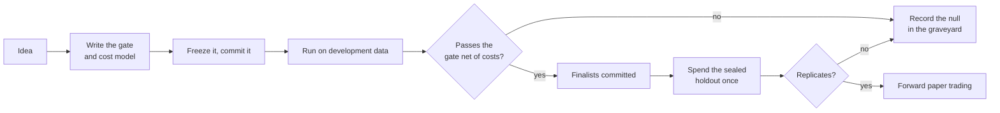
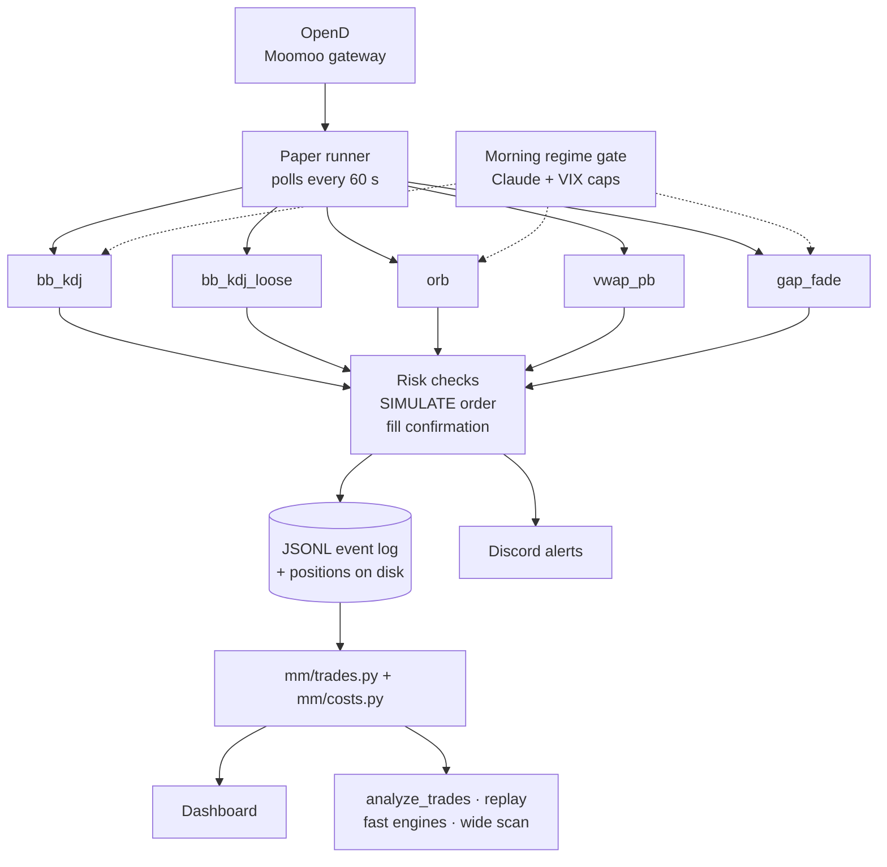

<h1 align="center">moomoo-trader</h1>

<p align="center">
  <strong>I built a trading lab to find out whether simple intraday strategies beat transaction costs.<br>
  Five months and 96,129 trades later, they don't. This repo is the evidence.</strong>
</p>

<p align="center">
  
  
  
  
  
</p>

<p align="center">
  <a href="https://flyboy-byte.github.io/moomoo-trader/"><b>Website</b></a> •
  <a href="#the-result">The result</a> •
  <a href="#how-i-knew-it-was-a-null">Method</a> •
  <a href="#the-bugs-that-fooled-me">The bugs</a> •
  <a href="#the-live-experiment">Live experiment</a> •
  <a href="#run-it-yourself">Run it</a>
</p>

---

> [!NOTE]
> **A personal research project, not a trading product or advice.** It has only ever traded Moomoo's
> simulated account and has never placed a real order. The code and docs were written with
> [Claude Code](https://claude.com/claude-code), with periodic independent reviews by Codex. I
> directed the work, ran it, and made the calls.

## The question

Can a retail trader, using well-known intraday rules on the most liquid US ETFs, make money
**after** realistic trading costs?

I started in May 2026 with five textbook strategies (Bollinger-band mean reversion, opening-range
breakout, VWAP pullback, gap fade) running on Moomoo's paper account, and a dashboard that
reported a small profit. Most of the project since then has been trying to find out whether that
profit was real.

## The result

**No. Nothing I tested has a demonstrable edge once costs are counted.** Three separate,
preregistered tests all came back null:

| Test | What it covered | Outcome |
|---|---|---|
| **Live paper trading** | 102 trades on SPY, QQQ and IWM | Gross **+$12.92** (PF 1.19) became net **−$0.57** (PF 0.99) once costs were modeled. The profit *was* the costs. |
| **Wide scan** | 96,129 trades, 85 liquid ETFs and large caps, 2022–2026 | All four strategies lose after costs; three are significantly negative. None of 340 symbol×strategy lanes survived multiple-testing correction. |
| **Daily-horizon scan** | Overnight holds, 200-day trend, vol scaling, momentum, weekly reversal, same 85 symbols | Overnight holding earns about +3 bps gross a night and gives all of it back to costs. Nothing passes. |

The wide scan in detail:

| Strategy | Trades | Gross bps / trade | Net bps / trade (95% CI) |
|---|---:|---:|---|
| ORB | 44,720 | +1.65 | −2.96 (−4.39 to −1.52) |
| VWAP pullback | 25,650 | +0.57 | −3.55 (−4.69 to −2.41) |
| Gap fade | 23,647 | +0.23 | −3.92 (−5.22 to −2.63) |
| BB+KDJ | 2,112 | +2.24 | −1.88 (−6.16 to +2.44) |

Only ORB shows an edge before costs, and it is smaller than SPY's 1.5 bps round trip. For
comparison, the median symbol simply held rose 56 % over the same window.

That is not surprising: this is one of the most competed trades there is. What's worth sharing is
that the project is built so a null is believable.

<p align="center">
  
</p>

<p align="center"><sub>The live dashboard. The ⚠ marks a net-PF interval that contains 1.0.</sub></p>

## How I knew it was a null

The failure mode this project is built against is quietly retuning until a backtest looks good.
So the rules came first:

| Rule | Why it matters | Where it lives |
|---|---|---|
| **Gates are written before the data.** Sample-size thresholds and actions per strategy; changing one needs a dated amendment. | Stops me rationalizing a result after seeing it. | [`docs/evaluation_criteria.md`](docs/evaluation_criteria.md) |
| **Net is the ruler.** Every profit-factor threshold means net PF under a frozen cost model that is deliberately not a tunable knob. | Costs are what erased the profit. | [`mm/costs.py`](mm/costs.py) |
| **Uncertainty is bootstrapped by trading day**, not by trade. | Same-day trades across symbols aren't independent; per-trade intervals look much tighter than they are. | [`mm/stats.py`](mm/stats.py) |
| **Two engines must agree** before the fast one is trusted for a scan. | The first attempt *failed* this check, and that failure is recorded. | [`scripts/cross_validate_engines.py`](scripts/cross_validate_engines.py) |
| **A sealed holdout** (2019–2021). | The scan script refuses to compute it until the finalist list is committed. | [`scripts/wide_scan.py`](scripts/wide_scan.py) |
| **Nothing is deleted.** Every dead idea, bug and wrong claim stays on record with its data. | Dead ends don't get re-explored. | [`docs/strategy_graveyard.md`](docs/strategy_graveyard.md) |



A gate that never says "no" isn't a gate, so nothing was rescued by relaxing a threshold.

## The bugs that fooled me

The most useful thing this project produced is probably the record of how its own numbers were
wrong. A few of them, all written up in the [graveyard](docs/strategy_graveyard.md):

<details>
<summary><b>The reporting layer showed a profit that wasn't there</b></summary>

<br>

The dashboard paired trades its own way, in per-share P&L, with no costs. Re-pairing the same
trades through one canonical module and applying a cost model turned +$12.92 into −$0.57. Then the
same metric (profit factor) turned out to have been re-implemented in several places, and the
copies had drifted. It happened repeatedly before I wrote a test that fails if anyone defines a
second one.

</details>

<details>
<summary><b>Look-ahead and stale state</b></summary>

<br>

- A KDJ golden cross from yesterday's close leaked into the first bars of the next session.
- Config objects bound at import time went stale after a test reload, and one stale value
  silently poisoned the live research archive.
- A bootstrap confidence interval returned `nan` on mostly-winning samples, with no error.

</details>

<details>
<summary><b>Things that were switched on but did nothing</b></summary>

<br>

- A live "skip large gap-up shorts" filter was configured and enabled for seven weeks, and was
  never wired in.
- A keyword clash made the AI scorer raise on every block; the runner swallowed the error, so
  trades were blocked by a crash rather than by a decision.
- The weekly AI synthesis failed silently five weeks in a row on a truncated token limit.

</details>

<details>
<summary><b>The data itself</b></summary>

<br>

- A price of 999.0 sat in four years of IWM bars. A note said it had been removed, and it hadn't.
- Dividends silently rescale adjusted prices, so merged downloads had spliced two price bases
  about 25 bps apart. Archives are now rebased, never spliced.
- Test runs leaked output into the real research logs.

</details>

## What's worth keeping

Not the strategies. The reusable parts are the method and the tooling:

- **One cost-aware ruler.** `mm/trades.py` pairs every trade and `mm/costs.py` prices it; the
  dashboard, the EOD report and the analysis script are tested to agree.
- **Replay of the real code path.** `mm/replay.py` drives the live runner bar by bar against a fake
  broker, so backtests exercise the same code that trades.
- **Preregistration as code.** Frozen configs, day-blocked bootstrap, Benjamini–Hochberg
  correction, and a holdout the scripts refuse to open early.
- **A bug record honest enough to learn from.**

## The live experiment

The paper runner stays on as a forward test of the frozen configuration. As of 2026-10-23 (36 days
since the 2026-09-17 freeze):

| | |
|---|---|
| Trades | 45 |
| Net profit factor | **0.62** (95% CI 0.26 – 1.25) |
| Net return on capital | −0.65 % |
| SPY buy-and-hold, same window | −0.10 % |

The interval includes 1.0, so this is consistent with zero edge, and it is too few trades to say
more. I'm not planning further strategy work. The runner stays up for execution validation and
the record.

## How it works



<details>
<summary><b>The five strategies</b></summary>

<br>

All run on SPY, QQQ and IWM with 5-minute closed bars. Live values are in
[`docs/frozen_config_2026-09-17.env`](docs/frozen_config_2026-09-17.env); full specs are in
[`docs/ARCHITECTURE.md`](docs/ARCHITECTURE.md).

| Strategy | Idea | Entry | Exit |
|---|---|---|---|
| `bb_kdj` | Mean reversion | Close ≤ lower Bollinger band, KDJ golden cross, ≥ 2 bonus signals, ranging regime | Back to the BB middle, or 1 × ATR stop |
| `bb_kdj_loose` | Measurement lane | Same signal with no bonus or regime gate, to measure what the gates are worth | Same |
| `orb` | Opening-range breakout | Close beyond the 15-min range (30-min for IWM) with a volume surge; no entries after 12:30 ET; shorts on SPY only | 1.5 × range target, the far side of the range, or 15:45 |
| `vwap_pb` | VWAP flush-and-reclaim | Wick below VWAP that closes above it, on a quiet bar, in a session that hasn't chopped | Close back below VWAP, ATR stop, or 15:45 |
| `gap_fade` | Opening-gap fade | 9:35 bar rejects a 0.3–2 % gap; gap-up shorts above 1 % are skipped | Half the gap filled, a stop beyond the first bar, or 11:00 |

</details>

## Run it yourself

This is a research record more than a product, but it does run.

> [!WARNING]
> Needs a [Moomoo](https://www.moomoo.com) account and
> [OpenD](https://openapi.moomoo.com/moomoo-api-doc/) running at `127.0.0.1:11111`. Moomoo's
> history API allows **100 distinct symbols per 30 days**; the bulk fetch refuses to overspend it.

```bash
git clone https://github.com/flyboy-byte/moomoo-trader.git
cd moomoo-trader
python -m venv .venv && source .venv/bin/activate
pip install -r requirements.txt

cp .env.example .env                    # TRD_ENV=SIMULATE stays
python scripts/health_check.py          # is OpenD reachable?
python scripts/fetch_candles.py --symbol US.SPY --start 2026-01-02
python scripts/replay_paper.py --latest # the real runner against a fake broker
python scripts/analyze_trades.py --all  # gross vs net, CIs, benchmark
python -m pytest tests/ -q              # some tests skip without local candle data
```

`./start.sh` starts the paper runner and `python scripts/web_dashboard.py` serves the dashboard on
`http://localhost:8080`. Safety is enforced in code: `TRD_ENV=SIMULATE`,
`LIVE_TRADING_ENABLED=false` is checked before every order, and `touch STOP_TRADING.txt` pauses
the runner. There is no live-order path.

## Where things are

| Doc | For |
|---|---|
| [`docs/strategy_graveyard.md`](docs/strategy_graveyard.md) | Every finding, bug and dead end, with data |
| [`docs/evaluation_criteria.md`](docs/evaluation_criteria.md) | Preregistered gates, the cohort, and the wide-scan rules |
| [`docs/PLAN.md`](docs/PLAN.md) | The plan and how the project was closed out |
| [`docs/ARCHITECTURE.md`](docs/ARCHITECTURE.md) | Data flow, strategy specs, config reference, kill switches |
| [`docs/PROJECT_MAP.md`](docs/PROJECT_MAP.md) | File-by-file map |
| [`WORKFLOW.md`](WORKFLOW.md) | Local and VPS operations |

## License

[MIT](LICENSE)
